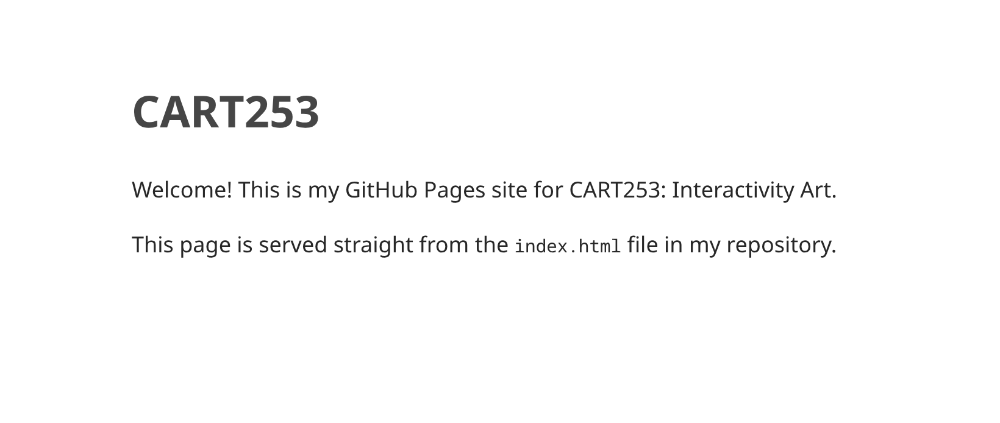
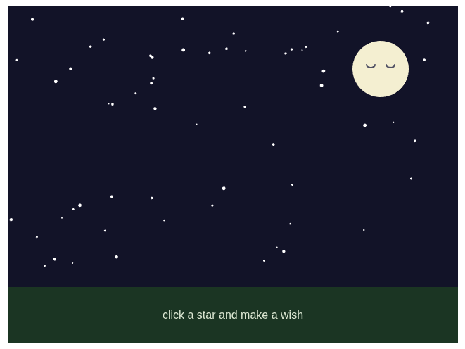

# Reflective Journal

## September 16, 2026

This week I built the first version of my CART253 course website using Markdown and GitHub. I'd used Markdown a lot before. It's a very common format in AI workflows, and the backbone of most github projects.

What surprised me most was how difficult it is to write JS/HTML/CSS, now that I have been using other tools for such a long time.I also did not know that github had natural webhost options, I usually use cloudflare.

I'm not under any impression that this project will last longer than needed. So far, I have no incentives to put in more effort than needed, but I do want to keep things presentable. 

### Screenshot

## September 23, 2026

This week I built 3 different websites around the idea of "normal" and "weird", and added these projects to the github repo. I chose to take the assignment a bit lighter considering the open nature of the task and targeted some artists I enjoy, and defined "weird" as a form of subversion. In this case, I specifically aimed to represent "wall of text" and "anti-UI" ideas as the most likely to be considered "weird". These are horrible websites by my standards, but they are interesting. Considering I usually build only for a functional reason, this is the first time I was motivated by more chaotic ideation. 

## October 07, 2026

I had to rush my work this week. I'm mentally gone and a lot happened quickly. On the topic of conditionals, these are fundamentals that are needed to run any code. Variations of gates or if statements allow projects like this one to run, but fundamentally the hardest thing is finding the action/reaction that fits the need of the system without over complicating the logic. I hope the repo can at least be fun to anyone looking at it. 

## October 21, 2026

The functions are the main theme for this week. I decided to keep it simple and introduced the 3 projects as
clowns, fireflies, and buttons. I didn't learn that much here, but I did recall that the basic of OOP has always
revolved around functions, objects, and classes. I still recall how confusing these things where for me when I 
first encountered the idea that JAVA, or in this case JS, can expand forever using these neat little boxes. I'll
be honest, I still don't fully understand this black magic, or function languages, but it's fun to mess with.

## November 06, 2026

Arrays are a weird thing for me. I used to confuse lists, dictionaries, and arrays as interchangeable concept in programming. To a degree, I was right, these words are in ways "collections of words/symbols". With JS these concepts became concrete differences of methods. The difference between a  FIFO and a heap became vital to efficient execution. Now, I've returned to the odd abstraction of the abstraction that ordering things is less about definitions or efficiency, call it tomato or potato, it's ultimately the expression of this "group of things" which as so many variations across languages and technical terminology. Odd how it all blurs together.  
